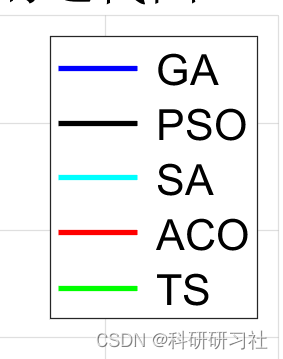
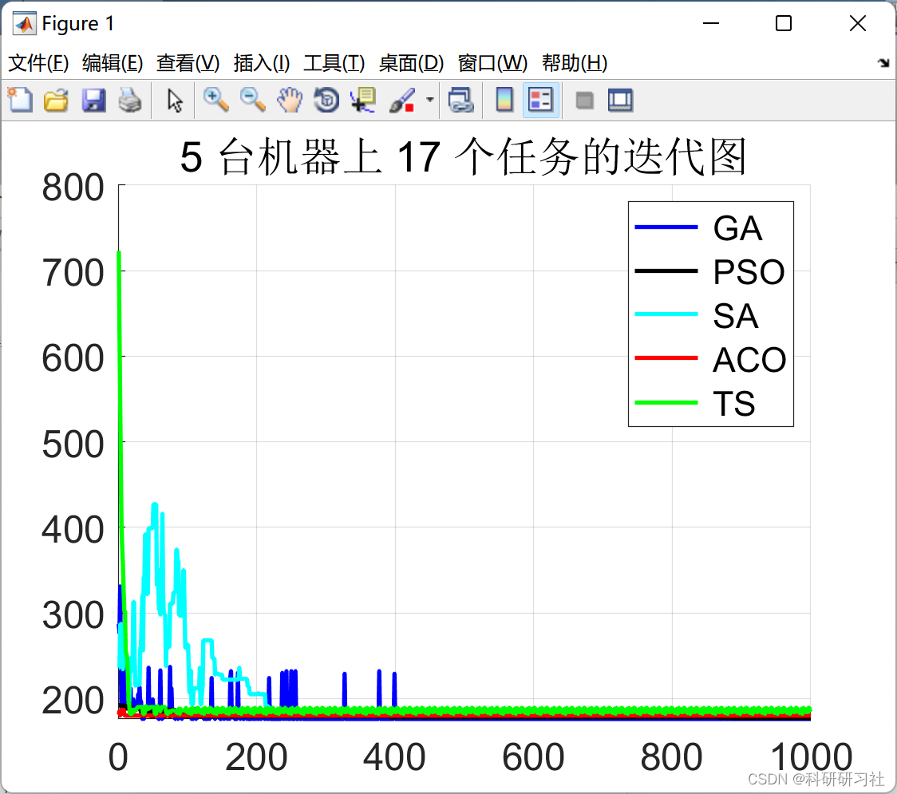
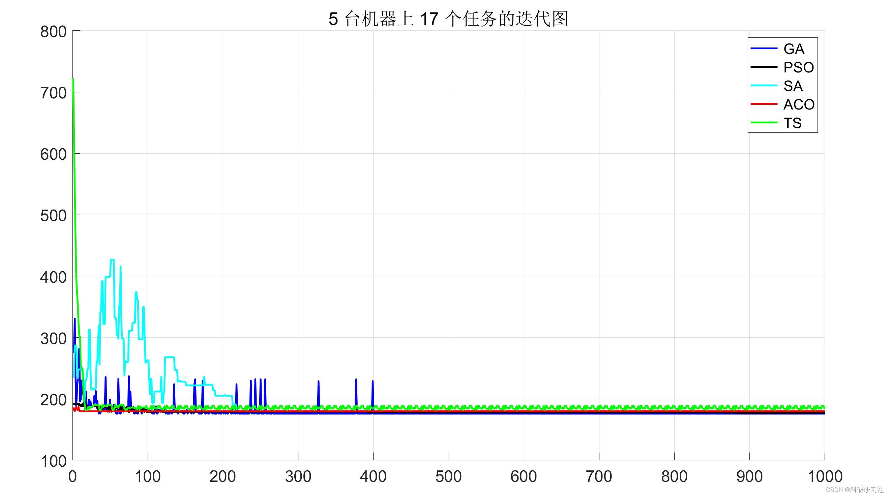
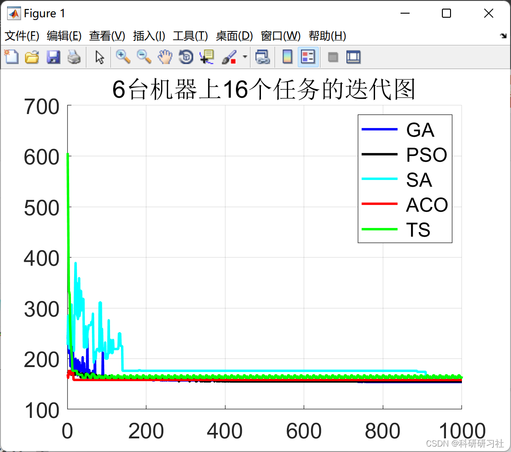
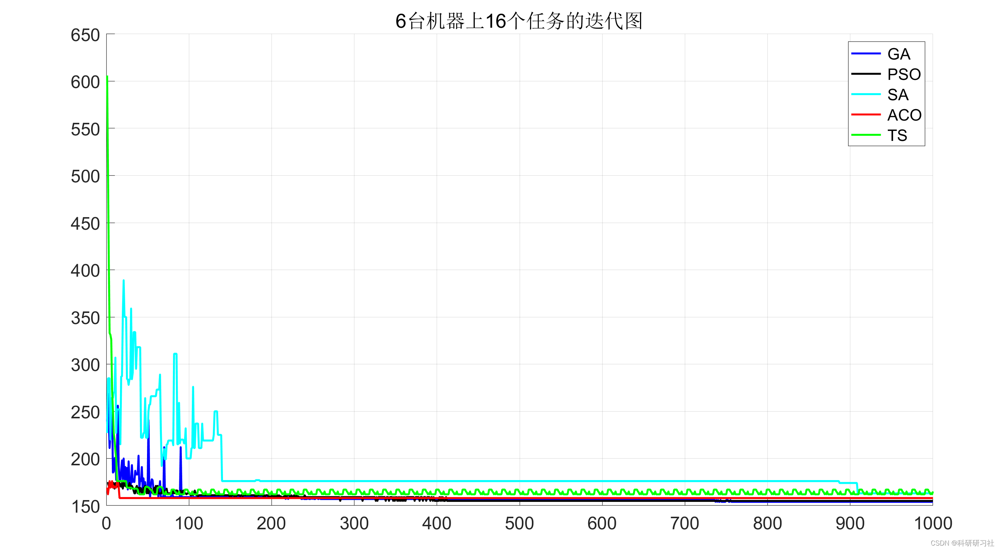
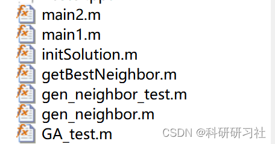

# [Shop Scheduling] Comparative Study of Shop Scheduling Based on GA/PSO/SA/ACO/TS Optimization Algorithm (Matlab Code)

1. Overview of the Flexible Job Shop Scheduling Problem (FJSP)
The Flexible Job Shop Scheduling Problem (FJSP) is a widely applied problem in discrete manufacturing and process industries, proven to be a typical NP-hard problem.
FJSP is an extension of the Job Shop Scheduling Problem (JSP), where each job piece can be processed on a finite number of machines with different processing times on each machine, allowing for flexible resource selection to enhance the agility of the scheduling and closer alignment with actual production. Currently, metaheuristic algorithms are commonly used to solve FJSP, which mainly fall into two categories: population-based algorithms and local search algorithms. Lu Jiahui et al. proposed a hybrid optimization algorithm to solve the Flexible Job Shop Scheduling Problem, and designed a discrete update operator that makes the Jaya optimization algorithm more suitable for FJSP. The combination of two novel neighborhood structures improves the algorithm's ability to explore solutions. Yu et al. [2] combined the Chemical Reaction Algorithm with the Tabu Search, designing four operations to ensure population diversity to achieve optimal global exploration. The inclusion of Tabu Search enhances the local search capability of the hybrid algorithm.
2. Description of FJSP
FJSP can be described as follows: n jobs (represented by J1, J2,..., Ji,..., Jn) are processed on m machines (represented by M1, M2,..., Mm). Each job consists of a sequence of processes; all processes are processed in a predefined order; each process has a set of possible machines, and the processing time is determined by the assigned machine. Therefore, FJSP is composed of two subproblems: machine selection and process sequencing.
Additionally, FJSP must satisfy the following constraints:
1) A single machine can only process one process at a time.
2) A single job can only be processed on one machine at a time.
3) All workpieces can be processed at the moment of 0.
4) The processes between different workpieces are independent, and there is a sequential constraint between the processes of the same workpiece.
5) Each workpiece cannot be interrupted during the processing process.
6) Machine preparation time and workpiece transfer time are ignored.
This paper optimizes the objective function as maximizing the completion time while minimizing the longest completion time, setting the completion time for each workpiece. The objective function is (the formula is important, so it needs to be handwritten):
3.1 Running results
This paper includes five optimization algorithms for comparison, namely: genetic algorithm, particle swarm optimization algorithm, simulated annealing algorithm, ant colony optimization algorithm, and tabu search algorithm.
3.1 Main1 running results
Below is the comparison of running results:
Edit
Edit
3.2 Main2 running results
Edit
4 Matlab code This only displays part of the code, all codes and explanations of the article can be found in:
[Shop Scheduling]Comparative Study of Shop Scheduling Based on GA/PSO/SA/ACO/TS Optimization Algorithms (Matlab Code Realization)
function [costs, bestSol] = PSO(jobs, m, n, particals, iterations, costFunc)\n  c1 = 1.4944;\n  c2 = 1.4944;\n  w = 0.79;\n  gbests = ones(1, n);\n  gbest = costFunc(gbests, jobs, m, n);\n  lbests = randi(m, particals, n);\n  lbest = ones(1, particals);\n  costs = ones(iterations, 1);\n  costsEnd = 0;\n  for i = 1:particals\n      lbest(i) = costFunc(lbests(i, :), jobs, m, n);\n      if lbest(i) < gbest\n          gbest = lbest(i);\n          gbests = lbests(i, :);\n      end\n  end\n  x = lbests;\n  v = zeros(particals, n);\n  \n  for i = 1:iterations\n      ibest = costFunc(ones(particals, n), jobs, m, n);\n      r1 = rand(particals, 1);\n      r2 = rand(particals, 1);\n      v = w*v + c1 * bsxfun(@times, r1, lbests - x) + ...\n        c2 * bsxfun(@times, r2, (bsxfun(@minus, gbests, x)));\n      x = round(x + v);\n      %x = bsxfun(@mod, x, m) + 1;\n      x(x < 1) = 1;\n      x(x > m) = m;\n      for j = 1:particals\n          c = costFunc(x(j, :), jobs, m, n);\n          if c < ibest\n              ibest = c;\n          end\n          if c < lbest(j)\n              lbest(j) = c;\n              lbests(j, :) = x(j, :);\n          end\n      end\n      costsEnd = costsEnd + 1;\n      costs(costsEnd) = ibest;\n      [ilbest, idx] = min(lbest);\n      %ibest\n      ilbests = lbests(idx, :);\n      if ilbest < gbest\n          gbest = ilbest;\n          gbests = ilbests;\n      end\n  end\n  bestSol = gbests;\nend\n  
Editorial 
5 References [1] Wang Yufang, Zeng Yazhi, Jiang Yafei. The Problem of Flexible Job Shop Scheduling Based on Adaptive Grey Wolf Optimization Algorithm [J]. Modern Manufacturing Engineering, 2022(7):1-10  
[2] Zhang Shoujing, Du Haotian, Hou Tiantian. An Improved NSGA-II Algorithm for Solving the Multi-Objective Dual-Resource Flexible Workshop Scheduling Problem [J]. Mechanical Science and Technology, 2022,41(5):771-778  
[3] Huang Xuewen, Chen Shaofen, Zhou Tianyu, Sun Yuting. A Review on Genetic Algorithms for Solving Flexible Job Shop Scheduling [J]. Computer Integrated Manufacturing System, 2022,28(2):536-551

## Images

<!-- PAYMENT_BLOCK -->

## Get this dataset

- Payment link (Stripe): [Buy now](https://buy.stripe.com/3cs8yP7sY87d0vu9AB)
- Payment QR code: 

<!-- /PAYMENT_BLOCK -->
